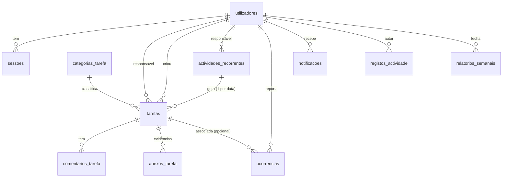
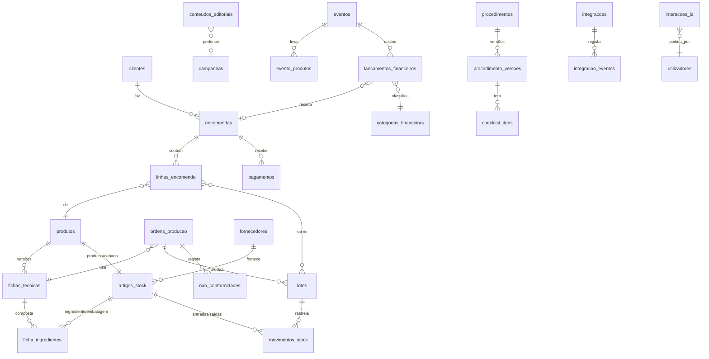

# 3. Modelo de dados

Convenções: chaves UUID; códigos legíveis por sequência (`T-0001`, `O-0001`); datas `date` (prazos) e
`timestamptz` (momentos, guardados em UTC, apresentados em Africa/Luanda); enumerações como texto com `CHECK`
(acrescentar estados no futuro é uma migração simples); `is_demo` marca dados de demonstração; valores monetários
`numeric(14,2)` com coluna de moeda (Kz por omissão) a partir da Fase 4.

## Fase 1 — implementado (migração `0001`)

| Tabela | Campos principais | Regras na base de dados |
|---|---|---|
| `utilizadores` | nome, email, password_hash (bcrypt), funcao (`ceo`/`marketing`/`producao`), cargo, activo, deve_mudar_password, tentativas_falhadas, bloqueado_ate, ultimo_login_em | email único sem distinção de maiúsculas |
| `sessoes` | utilizador_id, token_hash (SHA-256), expira_em, ultima_actividade_em, revogada_em, ip, user_agent | token_hash único |
| `categorias_tarefa` | nome, area, cor, activa | nome único |
| `tarefas` | numero, titulo, descricao, categoria_id, responsavel_id, criado_por_id, data_inicio, prazo, prioridade, estado, requer_aprovacao, motivo_bloqueio, resultado_esperado, criada_em, concluida_em, submetida_em, aprovada_por_id, aprovada_em, actividade_recorrente_id, data_referencia, versao | início ≤ prazo; bloqueada ⇒ motivo; concluída ⇒ data de conclusão; (actividade, data) único |
| `comentarios_tarefa` | tarefa_id, autor_id, tipo (`comentario`/`submissao`/`rejeicao`/`bloqueio`), texto | — |
| `anexos_tarefa` | tarefa_id, nome_ficheiro, tipo_mime, tamanho_bytes, conteudo (bytea), descricao, carregado_por_id | — |
| `ocorrencias` | numero, tipo, gravidade, estado, titulo, descricao, tarefa_id, reportada_por_id, resolucao, resolvida_por_id, resolvida_em | — |
| `actividades_recorrentes` | nome, area, responsavel_id, categoria_id, frequencia, dia_prazo, procedimento_ref, indicador, prioridade, requer_aprovacao, activa | — |
| `regras_decisao` | decisao, area, nivel (`autonoma`/`informar_ceo`/`aprovacao_ceo`), funcao_responsavel, limite_valor_kz, observacoes | — |
| `notificacoes` | utilizador_id, tipo, titulo, mensagem, ligacao, chave_dedup, lida_em | chave_dedup única (alertas não se repetem) |
| `relatorios_semanais` | semana_inicio, conteudo (JSONB — fotografia), notas_ceo, gerado_por_id | uma por semana |
| `registos_actividade` | utilizador_id, accao, entidade, entidade_id, resumo, alteracoes (JSONB antes/depois), ip | **trigger impede UPDATE/DELETE** |
| `configuracoes` | chave, valor (JSONB) | — |

## Fases 2–6 — modelo previsto (não implementado)

Regras de consistência previstas:
- **`movimentos_stock` só de acréscimo** (mesmo trigger que o registo de actividade); o stock disponível é a soma dos
  movimentos (vista materializada), correcções fazem-se por movimento de *ajustamento* com motivo.
- Concluir uma ordem de produção, numa transacção: cria o lote (número, validade), movimento de entrada do produto
  acabado e movimentos de consumo de cada ingrediente/embalagem segundo a ficha técnica.
- Encomenda: `estado` (recebida → em preparação → pronta → entregue / cancelada) separado de `estado_pagamento`.
  A saída de stock acontece na entrega (configurável); **a receita só conta como recebida quando existe `pagamento`**.
- Finanças distinguem facturação (encomendas entregues), recebimentos (pagamentos), despesas e resultado.
- Custo de produção = matérias-primas + embalagens + mão-de-obra directa + outros custos atribuíveis (ficha técnica);
  margem bruta = preço − custo directo; margem % = margem / preço × 100.
- `moeda` em todas as tabelas monetárias (AOA por omissão) e `taxas_cambio` para outras moedas.
